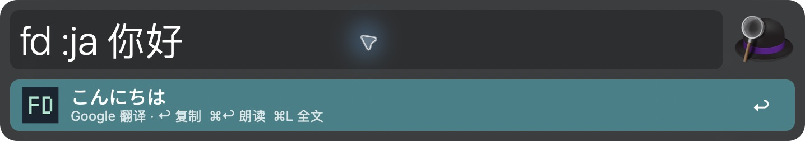
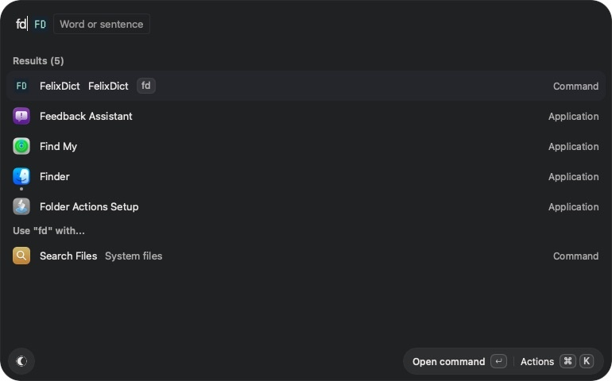
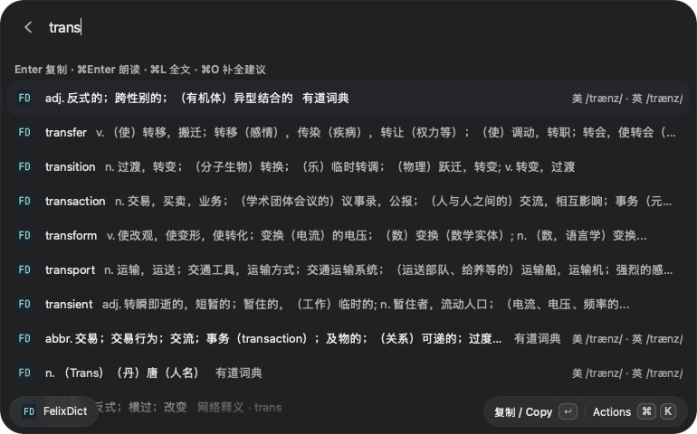

# FelixDict

[中文](README.md) · **English**

FelixDict brings **dictionary lookup and translation to Alfred, Vicinae, and Raycast**. Look up definitions and pronunciation, find a word from its first few letters, translate phrases and sentences, and listen to results—all from your launcher.

## Features

- **English–Chinese dictionary**: definitions by part of speech, British and American phonetics, word forms, and web meanings.
- **Prefix suggestions**: type the first few letters of an English word, compare candidates and their meanings, then complete the word to look it up.
- **Multilingual translation**: automatic source-language detection and 11 target languages, including Chinese, English, Japanese, Korean, and French. Set preferred targets or override them with a prefix such as `:ja`.
- **Keyboard actions**: copy, speak, and view full results without reaching for the mouse.
- **Progressive results and caching**: services run in parallel, results appear as they arrive, and repeated queries can use the local cache.

Youdao dictionary and Google translation are enabled by default, with no API key configuration required. Dictionary lookup and prefix suggestions cover English–Chinese; other languages use translation services. Queries require an internet connection. OCR, vocabulary collections, AI translation, and a complete offline dictionary are not included.

## Which version should I use?

Alfred, Vicinae, and Raycast are keyboard-driven application launchers. FelixDict is a plugin, so install the corresponding launcher first. A launcher's operating-system support does not mean FelixDict supports every one of those systems.

| Launcher | Desktop operating systems supported by the launcher | Current FelixDict support and validation | Installation |
| --- | --- | --- | --- |
| Alfred | macOS | macOS, tested on a real installation; requires Alfred 5 Powerpack and Node.js 18+ | [Alfred edition](apps/alfred/README.en.md) |
| Vicinae | Linux, macOS (Apple Silicon, beta), Windows (since 0.29.0) | Tested on macOS; Linux adaptation implemented but desktop interaction not yet tested on a real installation; Windows not yet supported | [Vicinae edition](apps/vicinae/README.en.md) |
| Raycast | macOS, Windows | Currently macOS only, tested on a real installation; Windows not yet supported | [Raycast edition](apps/raycast/README.en.md) |

- **macOS**: if you already use one of these launchers, install its FelixDict edition. The Alfred edition requires the paid Powerpack.
- **Linux / Arch / XFCE**: use the Vicinae edition. Desktop interaction still needs verification in your environment; speech requires a configured Speech Dispatcher (`spd-say`).
- **Windows**: FelixDict has no Windows-compatible edition yet. Installing Raycast or Vicinae does not make this repository's extensions compatible with Windows.

Launcher platform information checked on 2026-10-30: [Alfred](https://www.alfredapp.com/), [Vicinae platform overview](https://docs.vicinae.com/os-support) and [Windows installation guide](https://docs.vicinae.com/install/windows), and [Raycast for Windows](https://www.raycast.com/windows). Vicinae's overview has not yet updated its Windows status; this table follows the newer Windows installation guide.

## Downloads and installation

Choose **v0.2.0 or later** from [GitHub Releases](https://github.com/AndreGeng/FelixDict/releases) and download the asset for your launcher:

| Launcher | Release asset | Installation |
| --- | --- | --- |
| Alfred | `Alfred-FelixDict-*.alfredworkflow` | Double-click to import; requires Powerpack and Node.js 18+ |
| Vicinae | `FelixDict-Vicinae-*.zip` | Extract and copy the precompiled extension as described in INSTALL.md; no build needed |
| Raycast | `FelixDict-Raycast-source-*.zip` | Extract, run `npm ci` then `npm run dev:raycast`; requires Node.js 22.22.2+ |

An official precompiled `.rayext` bundle is also provided, but the tested Raycast installation route is the source ZIP; double-click import is not guaranteed. Download these named assets instead of GitHub's automatic Source code archives. Extensions are not yet listed in extension stores. Checksums are in `SHA256SUMS`.

## Alfred

For **macOS with Alfred 5 Powerpack**. Requires Node.js 18+ at runtime.

Open Alfred and type the keyword followed by your query:

```text
fd hello
fd trans
fd :ja 你好
```

**Definitions and pronunciation**


**Prefix suggestions**: type `fd trans` and use the meanings to find the word you need.


**Multilingual translation**: use `fd :ja 你好` to translate into Japanese.



Enter copies, ⌘Enter speaks, ⌘L opens Large Type, and Tab completes a suggested word.

→ [Alfred installation and usage guide](apps/alfred/README.en.md)

## Vicinae

Search for `fd` in Vicinae, select **FelixDict**, and press Enter to open the command. Then type `hello`, `trans`, or `:ja 你好` for live results and suggestions.

**Command entry**: the search result shows the `fd` alias and FD icon.



**Prefix suggestions**: candidates and their meanings appear together in the list.



Enter copies, ⌘Enter speaks, ⌘L opens scrollable full-text details, and ⌘O completes a candidate. On Linux, use Ctrl instead of ⌘. Vicinae displays titles and subtitles on the same line, unlike Alfred's two-line rows.

Vicinae screenshots were captured on macOS. Linux/XFCE desktop interaction has not been tested on a physical Linux installation. Linux speech requires a configured Speech Dispatcher (`spd-say`).

→ [Vicinae installation and usage guide](apps/vicinae/README.en.md)

## Raycast

For **macOS with Raycast**. Search for `fd` or `FelixDict`, press Enter to open the command, then type a word or sentence. You can set the command's Alias to `fd` under Raycast Settings → Extensions.

**Prefix suggestions and phonetics**


**Multilingual translation**: type `:ja hello` for a Japanese translation.


Enter copies, ⌘Enter speaks while keeping the window open, ⌘L opens full-text details, and ⌘O completes a candidate. As in Vicinae, live dictionary suggestions appear inside the command.

Currently installed from source, not yet available in the Raycast Store. Run `npm ci` and `npm run dev:raycast` from the repository root. After a successful build, you can stop the development command; the extension remains installed.

→ [Raycast installation and usage guide](apps/raycast/README.en.md)

Screenshots show real query results. Both language editions use the same Chinese interface screenshots; online results may vary. Dictionary rows speak the query word, translation rows speak the translated text, and suggestions speak the complete candidate.

## Structure

```text
apps/
  alfred/                 CLI, Alfred JSON adapter, launcher, and packaging
  vicinae/                Vicinae React UI and extension installation
  raycast/                Raycast React UI and extension build
packages/
  core/                   Languages, providers, query state, cache utilities, result model
test/                     TypeScript regressions and Python packaging tests
docs/                     Shared documentation assets
```

npm workspaces manages dependencies with one root `package-lock.json`. Apps import `@easydict/core` rather than another app's source files. The core has no launcher SDK dependency; Alfred JSON and modifier fields belong to the Alfred adapter.

## Development

Requires Node.js 22.22.2+, npm, and Python 3 for Alfred packaging. All Node source, helper scripts, and tests use TypeScript with strict type checking.

```sh
npm ci
npm run typecheck  # TypeScript + Python (Pyright)
npm test
npm run build:alfred
npm run build:vicinae
npm run build:raycast
npm run package:release
npm run test:release
```

- `build:alfred` compiles core and CLI, then produces `dist/Alfred-FelixDict-0.2.0.alfredworkflow`. It does not import or replace your installed workflow.
- `build:vicinae` compiles core, then builds and installs the extension into your local Vicinae directory.
- `build:raycast` compiles and validates the extension without importing it; `dev:raycast` builds and imports it into local Raycast.
- `build` builds all three apps, including the local Vicinae installation.
- `test` compiles runtime code, runs TypeScript tests, and checks Alfred packaging.

Generated `dist/` files are not committed. The Alfred archive includes compiled JavaScript and a local copy of the shared package; users need no TypeScript or npm install. Its runtime still supports Node.js 18+.
Vicinae bundles shared code and does not depend on the checkout at runtime. Linux/XFCE desktop interaction has not been tested on a physical Linux installation.

## License and attribution

MIT. See [THIRD_PARTY.md](THIRD_PARTY.md) for upstream protocol and source attribution.

See [release workflow](docs/RELEASING.md).
