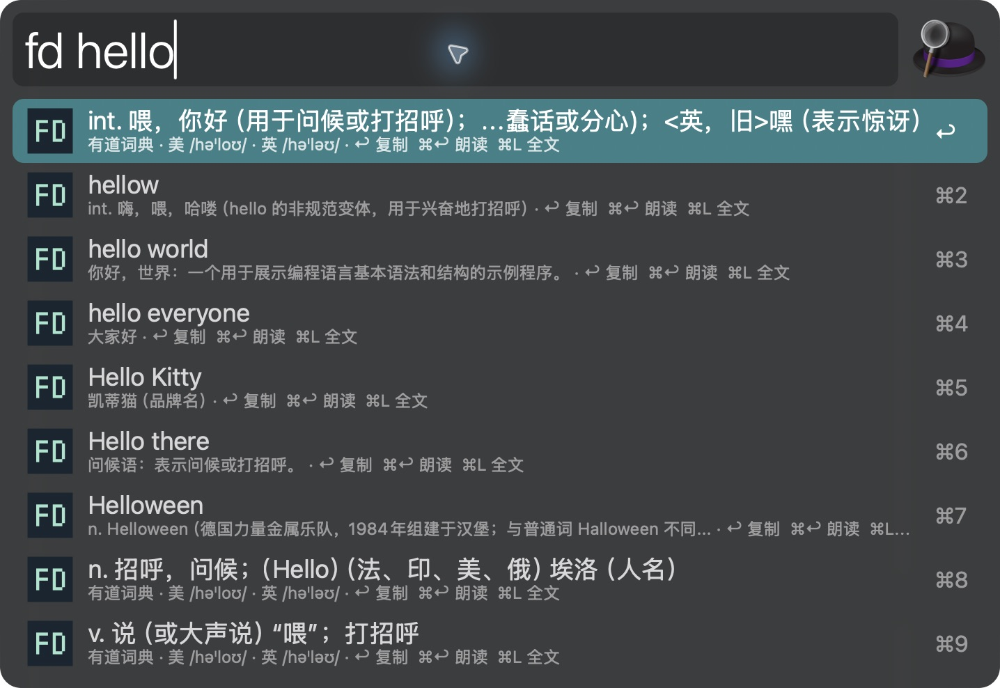
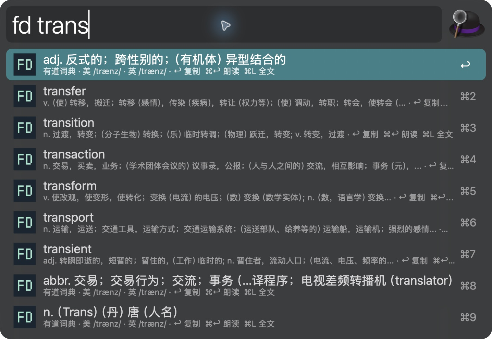
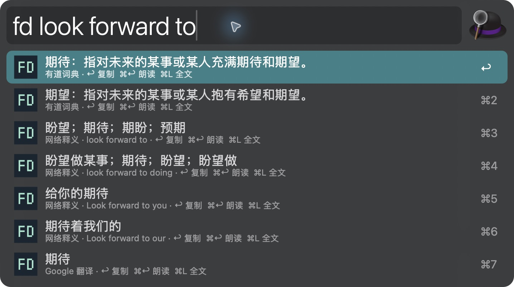

# Easydict for Alfred


> **Vicinae version**: this repository also includes [Easydict](../vicinae/README.en.md), sharing dictionary and prefix suggestions with a separate build and installation. The instructions below cover Alfred.

[中文](README.md) · **English**

Look up words, complete partial spellings, and translate across languages inside Alfred. Includes an English–Chinese dictionary and automatic translation for Japanese, Korean, French, and more.
No running Easydict or Raycast app and no translation API key required.



## Features

- **English–Chinese dictionary**: Youdao definitions by part of speech, US/UK phonetics, word forms, and web definitions.
- **Prefix suggestions**: find a word from its first few letters, with Chinese glosses. Press Tab to complete it and look up the full entry.
- **Multilingual translation**: Google is enabled by default. The source language is detected automatically. Configure a preferred target and secondary language, or specify the target per query. Defaults retain Chinese–English translation.
- **Keyboard actions**: Enter to copy, ⌘Enter to speak, and ⌘L to view the full result in Large Type.
- **Code identifiers**: split `camelCase`, `HTTPServer`, and `snake_case` before lookup.
- **Progressive results and caching**: providers run in parallel. Fast results appear first, and failures do not hide successful results.

A standalone Alfred Workflow with an English–Chinese dictionary and multilingual translation. OCR, vocabulary lists, AI translation, and a complete offline dictionary are not included.

## Installation

Requires **macOS, Alfred 5 with Powerpack, and Node.js 18+**. There are no npm runtime dependencies.

1. Build the package from the project directory:

   ```bash
   npm ci
   npm run build:alfred
   ```

2. Double-click `dist/Alfred-Easydict-0.1.6.alfredworkflow` to import or update it in Alfred.
3. Open Alfred and enter `ed hello`. The default keyword is `ed`.
4. If Node.js cannot be found, set `node_path` under **Workflows → Easydict for Alfred → Configure Workflow**.

The launcher checks `~/.local/bin/node`, `/opt/homebrew/bin/node`, `/usr/local/bin/node`, and `PATH`.
Building from source requires Node.js 22.6+, npm, and Python 3. Run the commands above at the repository root. An existing package only needs Node.js 18+; no development dependency installation is required.

## Usage

```text
ed hello
ed trans
ed look forward to
ed 你好
ed getHTTPServer
ed :ja hello
ed :fr 你好
ed The request was cancelled because a newer query was started.
```

### Multilingual translation

**Automatic translation**: the source language is detected automatically. Text translates into your **preferred target language**, or into your **secondary language** when the source already matches the preferred target.
The initial settings are `zh` (Simplified Chinese) and `en` (English), preserving Chinese-to-English and other-languages-to-Chinese behavior.

Set `target_language` and `secondary_language` in **Configure Workflow**, using two different language codes from the table below.
For example, with `en` and `ja`, `ed 你好` translates into English, `ed hello` into Japanese, and `ed :fr hello` still into French.
An explicit `:language` prefix overrides both settings. Each language pair uses a separate cache, so changing either setting does not reuse old translations.

**Explicit target**: use `ed :language-code text`. Use an ASCII colon (`:`) and a space between the language code and the text.

```text
ed 今日はいい天気です
ed 안녕하세요
ed Bonjour, comment allez-vous ?
ed :ja 你好
ed :ko 你好
ed :fr 你好
ed :en 東京
ed :zh Bonjour
```

Example queries and outputs (online translations may vary):

| Input | Example output |
| --- | --- |
| `ed 今日はいい天気です` | 今天天气很好 |
| `ed 안녕하세요` | 你好 |
| `ed :ja hello` | こんにちは |
| `ed :fr 你好` | Bonjour |
| `ed :de 谢谢` | Danke |

The following 11 target languages can be selected explicitly:

| Target language | Code | Target language | Code |
| --- | --- | --- | --- |
| Simplified Chinese | `zh` | English | `en` |
| Japanese | `ja` | Korean | `ko` |
| French | `fr` | German | `de` |
| Spanish | `es` | Italian | `it` |
| Portuguese | `pt` | Russian | `ru` |
| Arabic | `ar` | | |

Enable Google or Bing; Google is used by default. The translation service detects the source language. Short words, kanji-only text, and mixed languages can be ambiguous; use a prefix such as `:zh` or `:en` to fix the target.
Explicit targets show translation results only. Youdao's definitions, phonetics, and prefix suggestions retain their existing English–Chinese scope.
`⌘Enter` speaks the translation for translation results and the query word for dictionary results. Japanese containing kana, Korean, and Chinese use a matching installed system voice.

### Find a word from its prefix

Suggestions appear for **2–40 English letters** when Youdao is enabled. For example, `ed trans`:



Up to six candidates appear after the first definition of the current query. Select one with ↑ / ↓ and press **Tab** to complete the word and retrieve its detailed entry.
Candidates also support copying, speech, and Large Type. Chinese text, sentences, and inputs containing symbols do not trigger suggestions. A suggestion failure does not interrupt ordinary lookup.

### Keyboard shortcuts

| Key | Dictionary / translation result | Suggested word |
| --- | --- | --- |
| `↑` / `↓` | Select a result | Select a candidate |
| `Enter` | Copy the selected definition or translation | Copy the complete candidate word |
| `⌘Enter` | Speak the query word for dictionary results or translated text for translations; keep Alfred open | Speak the complete candidate; keep Alfred open |
| `⌘L` | Show the full selected result in Large Type | Show the candidate and its supplied gloss in Large Type |
| `Tab` | — | Complete the word and look it up |
| `Esc` | Dismiss the query | Dismiss the query |

In Large Type, the first Esc returns to the result list; a second Esc dismisses it. Speech uses the local macOS voice.
The suggestion endpoint may itself return shortened glosses. Press Tab to retrieve the full dictionary entry.

### Phrases and sentences



You can also select text in another app and use **Universal Actions → Easydict 查词 / 翻译**.
Alfred's global activation and Universal Actions shortcuts are configured in Alfred. This Workflow does not assign a fixed global hotkey.

## Configuration

Open **Alfred Preferences → Workflows → Easydict for Alfred → Configure Workflow**.

| Variable | Default | Description |
| --- | --- | --- |
| `keyword` | `ed` | Lookup keyword; you can use `yd` if it does not conflict with another Workflow |
| `providers` | `Youdao,Google` | Comma-separated list: `Youdao`, `Google`, `Bing` |
| `target_language` | `zh` | Preferred target language code, such as `en` or `ja` |
| `secondary_language` | `en` | Target when the source matches the preferred language; must be different |
| `node_path` | Auto-detected | Absolute path to the Node.js executable |
| `cache_hours` | `24` | 0–168 hours; 0 disables long-term caching but retains brief state for the active query |

Language preferences apply to Google/Bing translation. Youdao dictionary entries and prefix suggestions remain English–Chinese; remove `Youdao` from `providers` if you do not need them.

Youdao supplies dictionary entries and prefix suggestions; Google supplies translation. Bing is optional and disabled by default because its requests failed on the development network.
These providers use website endpoints. Availability can change with network conditions, rate limits, and upstream protocol changes.

`curl` inherits `HTTPS_PROXY` and `ALL_PROXY`; it does not automatically read macOS system proxy settings.
If Google is unreachable, set `providers` to `Youdao`, or configure a proxy in the Workflow environment.

## Troubleshooting

### No results, or Node.js is missing

Check the network, enabled providers, and `node_path`. This terminal command queries providers directly and prints Alfred JSON:

```bash
node apps/alfred/dist/cli.js --wait hello
```

## Privacy and runtime behavior

Query text is sent only to enabled Youdao, Google, or Bing services. With Youdao enabled, eligible English input also requests prefix suggestions.
There is no additional telemetry. The Workflow does not read browser data, accounts, credentials, Easydict / Raycast settings, or proactively read the clipboard.
Copying happens only when a copy action is executed; speech runs only after `⌘Enter`.

Cache files contain query text and results, have permissions `0600`, and are **not encrypted**.
The Workflow uses Alfred's `alfred_workflow_cache` directory; standalone CLI usage defaults to `~/Library/Caches/local.alfred-easydict`.
Expired files are cleaned up when new queries start; without subsequent queries they may remain on disk.
Use Alfred's Workflow cache cleanup feature to remove them.

Providers run concurrently with an eight-second total deadline per provider. During a query, Alfred reads local state every 0.3 seconds without starting duplicate in-progress requests.
There is no persistent service. Requests already started may continue until completion or timeout after Alfred is dismissed.

## Development

```bash
npm test
npm run build:alfred
```

Tests use Node.js's built-in test runner and the Python standard library. They cover response decoding, candidate actions, error isolation, progressive updates, caching, and package structure.
See [VERIFICATION.md](../../VERIFICATION.md) for live provider checks and Alfred UI acceptance records.

Screenshots show the current Chinese interface in Alfred 5.8.1 on macOS. Both language editions use the same real screenshots; online results may change.

## Attribution and license

Parts of the provider code are adapted from [Raycast Easydict](https://github.com/tisfeng/Raycast-Easydict). The Alfred presentation layer, cache, and Google HTTP adapter are independently implemented.
This is not an official Easydict product and does not require the upstream apps to run. See [THIRD_PARTY.md](../../THIRD_PARTY.md) for provenance and the reviewed revision.

[MIT License](../../LICENSE) · [Upstream MIT License](../../licenses/Raycast-Easydict-MIT.txt)
