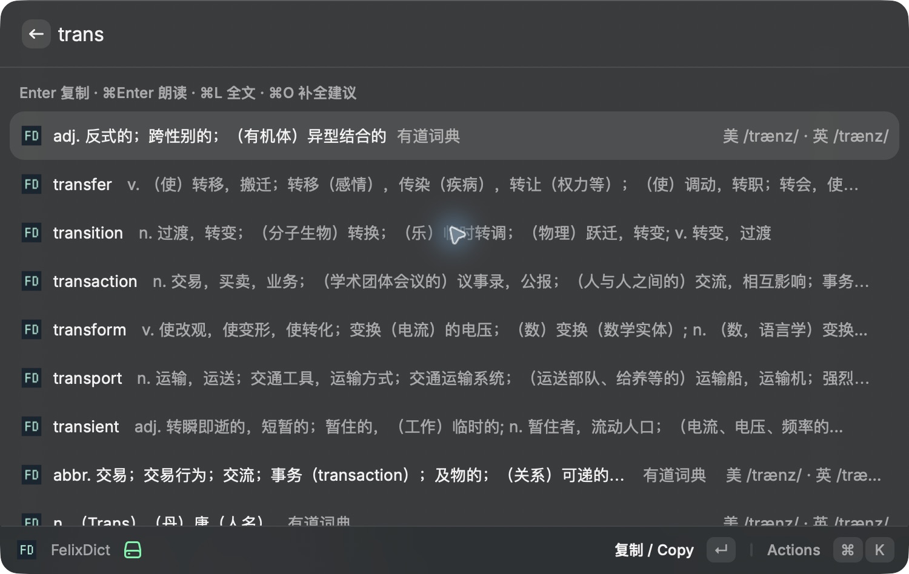
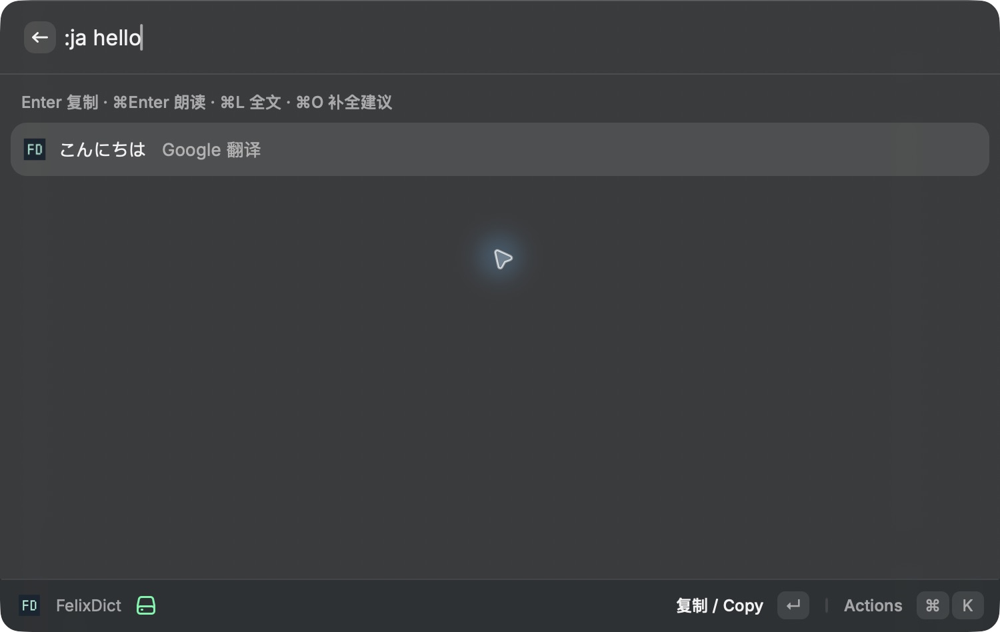

# FelixDict for Raycast

[中文](README.md) · **English**

Dictionary definitions, phonetics, spelling suggestions, and translation in Raycast. Shares query handling, cache expiry, result ordering, and speech with the Alfred and Vicinae apps. No Easydict app is required.

## Installation

Download `FelixDict-Raycast-source-*.zip`; no repository clone is needed. Use v0.2.0+ from [Releases](https://github.com/AndreGeng/FelixDict/releases). See the [installation guide](../../docs/install-raycast.md).

The following steps install from a repository checkout.

The FelixDict Raycast extension currently supports macOS only. Raycast itself also supports Windows, but this extension has not yet been adapted for Windows. Requires Raycast; source builds require Node.js 22.22.2+, npm, and the complete repository.

Run from the repository root:

```sh
npm ci
npm run dev:raycast
```

A successful development build imports the extension into your local Raycast. You can stop the development command afterward; the extension remains installed. Run it again to apply code changes.

To validate a production build without importing the extension:

```sh
npm run build:raycast
```

Not yet published to the Raycast Store.

## Usage

Search for `fd` or `FelixDict` in Raycast and press Enter to open the command. Type `hello`, `trans`, `:ja 你好`, or a sentence for live results and suggestions.

`fd` is a search keyword declared by the extension. For a dedicated alias, find the FelixDict command under Raycast Settings → Extensions and set Alias to `fd`. The optional argument field in root search passes an initial query; dictionary suggestions appear inside the command.

| Action | Shortcut | Behavior |
| --- | --- | --- |
| Copy | Enter | Copy a definition, translation, or complete candidate and close the window |
| Speak | ⌘Enter | Speak the query word for dictionary rows, translated text for translations, or the complete candidate; keep the window open |
| Full text | ⌘L | Open details; Esc returns to the list |
| Complete | ⌘O | Complete the selected candidate and look it up |

Selecting a suggested word fetches its phonetics. Japanese containing kana, Korean, and Chinese use a matching installed macOS voice; other text uses the default voice.

## Screenshots





## Settings and data

Configure these preferences in Raycast:

- **Preferred target language**: `zh` by default.
- **Secondary language**: used when the source matches the preferred target; defaults to `en` and must differ from the preferred target.
- **Providers**: `Youdao,Google` by default; `Bing` is optional.
- **Cache hours**: 24 by default, from 0 to 168; 0 disables caching.

Supported targets: `zh/en/ja/ko/fr/de/es/it/pt/ru/ar`. Use `:language text` for a one-off target. Youdao dictionary and prefix suggestions retain their English–Chinese scope.

Queries are sent to enabled services using system curl, with no API key required. A separate, unencrypted 5 MB cache lives in the Raycast extension directory. The extension does not read other plugins' settings or caches and does not automatically read the clipboard.

## Development

The UI lives in `src/search.tsx`; shared query sessions live in `packages/core/src/session.ts`. Builds bundle the shared package so the extension does not need the repository path at runtime.

```sh
npm run typecheck
npm test
npm run build:raycast
```
