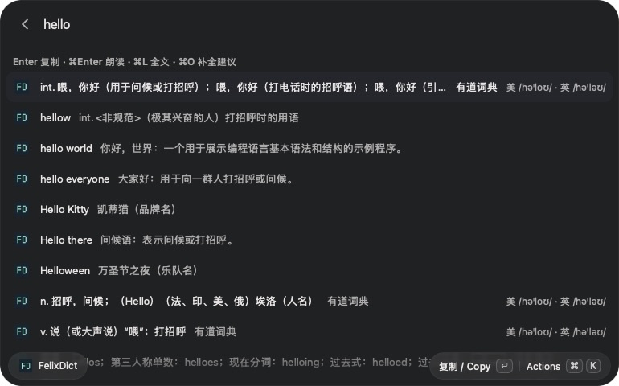
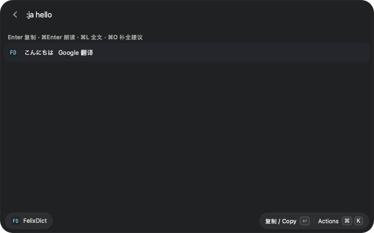

# FelixDict for Vicinae

[中文](README.md) · **English**

A Vicinae extension sharing dictionary, prefix suggestion, and translation logic with this repository's Alfred Workflow.
This is a separate local extension, not Easy Dictionary from the Raycast Store.

## Screenshots

Actual macOS screenshots showing dictionary results, phonetics, and prefix suggestions.







## Install

Requires Vicinae 0.29.2+, Node.js 22.22.2+ and npm for building, and `/usr/bin/curl` at runtime.
Build from the **complete repository** because the extension imports shared code from `packages/core/`:

```sh
npm ci
npm run build:vicinae
```

This installs into your local Vicinae extension directory. Search for the **FelixDict** command, listed under the **FelixDict** extension.
If it does not appear after the first build, quit and reopen Vicinae.
The built extension includes the shared code and does not depend on the repository location, Alfred, or Raycast.
This does not install or update the Alfred Workflow; its existing root build command remains available.

## Use

Search for `fd`, `查词`, `翻译`, `dictionary`, or `translate` in Vicinae, then select **FelixDict** and press Enter. These are search keywords, not exclusive aliases.

For a dedicated shortcut, set the FelixDict command alias to `fd` in Vicinae settings. Aliases are user settings; the extension only declares search keywords. After entering the command, type there for live suggestions; the main launcher’s optional argument field does not show dictionary suggestions.

Enter `hello`, `trans`, `你好`, `:ja hello`, or a sentence. You can also supply text through the command's optional argument.

| Action | macOS | Linux | Behavior |
| --- | --- | --- | --- |
| Copy | Enter | Enter | Copy the selected meaning, or the complete suggested word; close the window |
| Speak | ⌘Enter | Ctrl+Enter | Speak the query word for dictionary results, translated text for translations, or the complete suggested word; keep the list open |
| Full text | ⌘L | Ctrl+L | Open a scrollable detail page; Esc returns to the list |
| Complete | ⌘O | Ctrl+O | Complete a selected suggestion and look it up |

Actions are also available through the Actions menu. Full text uses Vicinae's detail page, rather than Alfred Large Type.
The meaning payload matches Alfred's, with pronunciation added when available; suggestion glosses may already be abbreviated by the provider. Use Complete Word to query the full word.
macOS speech uses `say`. Linux requires a working Speech Dispatcher (`spd-say`); missing speech support displays an error without blocking lookup or copy.
Linux desktop interactions have not yet been tested on a physical Linux installation.

## Settings

Find **FelixDict** in Vicinae's extension settings:

- **Preferred target language**: `zh` by default.
- **Secondary language**: `en` by default; used when the source matches the preferred language. Must differ from the preferred language.
- **Providers**: `Youdao,Google` by default; optionally add `Bing`.
- **Cache hours**: 24 by default, clamped to 0–168; 0 disables caching.

Supported targets: `zh/en/ja/ko/fr/de/es/it/pt/ru/ar`. An explicit `:language text` prefix overrides the defaults.
Youdao dictionary and suggestions retain their English–Chinese scope.
The extension's cache is separate from Alfred's, keyed by query, providers and language pair, and capped at 5 MB.
Queries are sent to the enabled online services. The local cache is not encrypted.

## Development

From the repository root:

```sh
npm test
npm run typecheck
npm run build:vicinae
npm run build:alfred  # Alfred package
```

Dependencies are managed by npm workspaces and the root lockfile. Alfred still needs no npm runtime dependencies.
Shared code remains in `packages/core/src/`. The extension maps existing result payloads into native rows to preserve ordering and copy/speech semantics.
It maintains its own asynchronous state and bounded cache, without Alfred workers or state files.
See [VERIFICATION.md](VERIFICATION.md) for tested scope and remaining manual checks.

Tab did not trigger the extension action in local testing with Vicinae 0.29.2, so completion uses ⌘O (Ctrl+O on Linux). Alfred keeps Tab.

The full-width list preserves Alfred’s result content and ordering, with pronunciation in a right-hand accessory to keep it visible beside long meanings. Selecting a suggestion fetches its pronunciation automatically. Use ⌘L (Ctrl+L on Linux) for full text. Vicinae displays titles and subtitles on the same line, unlike Alfred’s two-line rows.
